# DỮ LIỆU MÔ PHỎNG — KHÔNG PHẢI KẾT QUẢ KHẢO SÁT

Số dòng: 120. Không mặc định mỗi dòng là một người duy nhất.

## Q01. Bạn đang là sinh viên năm mấy?

| Lựa chọn | Số lượt | % người trả lời câu |

|---|---:|---:|

| Năm nhất | 32 | 26.67% |

| Năm hai | 24 | 20.00% |

| Năm tư trở lên | 29 | 24.17% |

| Năm ba | 35 | 29.17% |

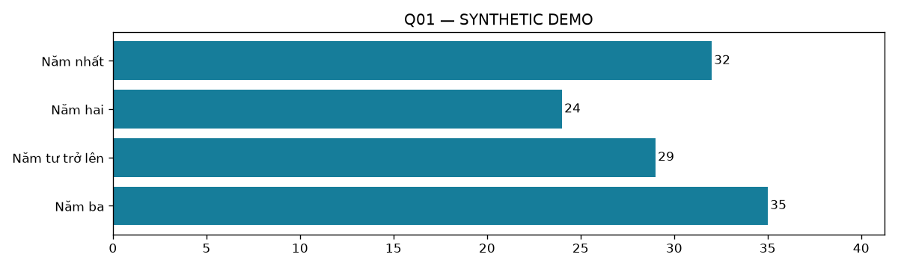

## Q02. Bạn đang học nhóm ngành nào?

| Lựa chọn | Số lượt | % người trả lời câu |

|---|---:|---:|

| Xã hội - nhân văn | 21 | 17.50% |

| Kinh tế - quản trị | 27 | 22.50% |

| Kỹ thuật - công nghệ | 23 | 19.17% |

| Khác | 29 | 24.17% |

| Sức khoẻ | 20 | 16.67% |

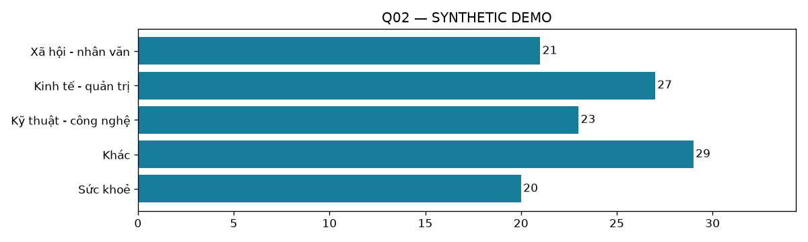

## Q03. Bạn đã sử dụng công cụ AI cho học tập trong 30 ngày qua chưa?

| Lựa chọn | Số lượt | % người trả lời câu |

|---|---:|---:|

| Có | 95 | 79.17% |

| Không | 25 | 20.83% |

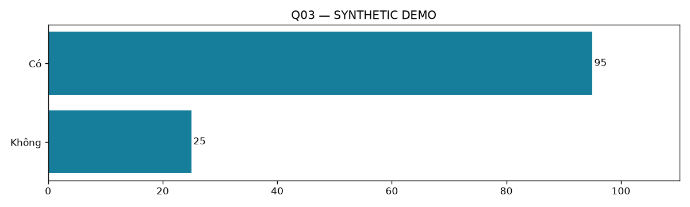

## Q04. Bạn sử dụng AI cho học tập với tần suất nào trong 30 ngày qua?

| Lựa chọn | Số lượt | % người trả lời câu |

|---|---:|---:|

| 5–7 ngày/tuần | 22 | 18.33% |

| 3–4 ngày/tuần | 29 | 24.17% |

| Dưới 1 ngày/tuần | 24 | 20.00% |

| 1–2 ngày/tuần | 20 | 16.67% |

| Không sử dụng | 25 | 20.83% |

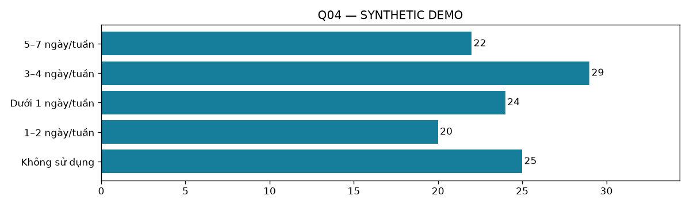

## Q05. Bạn đã dùng những công cụ AI nào cho học tập trong 30 ngày qua?

| Lựa chọn | Số lượt | % người trả lời câu |

|---|---:|---:|

| Gemini | 51 | 42.50% |

| ChatGPT | 33 | 27.50% |

| Microsoft Copilot | 36 | 30.00% |

| Khác | 36 | 30.00% |

| Claude | 34 | 28.33% |

| Không sử dụng | 25 | 20.83% |

Tổng % có thể vượt 100%; mẫu số là số người trả lời câu.

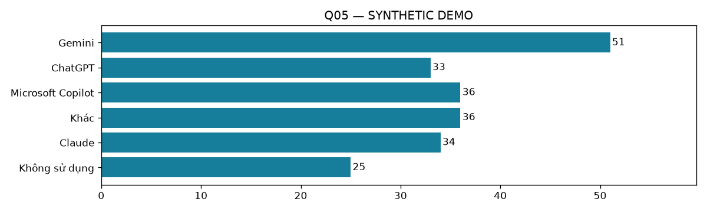

## Q06. Bạn dùng AI cho những hoạt động nào trong 30 ngày qua?

| Lựa chọn | Số lượt | % người trả lời câu |

|---|---:|---:|

| Soạn nội dung | 25 | 20.83% |

| Khác | 32 | 26.67% |

| Tóm tắt tài liệu | 28 | 23.33% |

| Luyện ngoại ngữ | 32 | 26.67% |

| Giải thích kiến thức | 22 | 18.33% |

| Lập trình | 27 | 22.50% |

| Lên ý tưởng | 24 | 20.00% |

| Không sử dụng | 25 | 20.83% |

Tổng % có thể vượt 100%; mẫu số là số người trả lời câu.

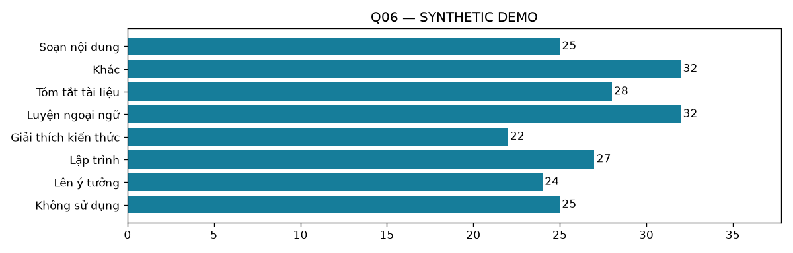

## Q07. Bạn thường dùng AI ở giai đoạn nào của bài tập?

| Lựa chọn | Số lượt | % người trả lời câu |

|---|---:|---:|

| Trước khi tự làm | 25 | 20.83% |

| Không sử dụng | 48 | 40.00% |

| Sau khi tự làm | 22 | 18.33% |

| Trong suốt quá trình | 25 | 20.83% |

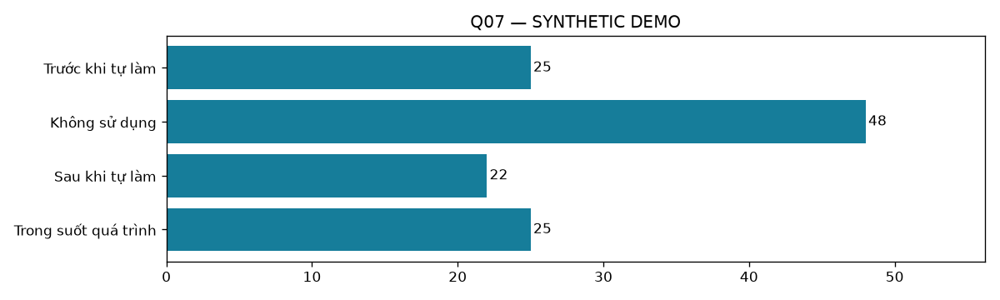

## Q08. Bạn có kiểm tra lại câu trả lời AI bằng tài liệu hoặc nguồn khác không?

| Lựa chọn | Số lượt | % người trả lời câu |

|---|---:|---:|

| Luôn luôn | 12 | 10.00% |

| Không bao giờ | 17 | 14.17% |

| Thỉnh thoảng | 18 | 15.00% |

| Hiếm khi | 17 | 14.17% |

| Không áp dụng | 39 | 32.50% |

| Thường xuyên | 17 | 14.17% |

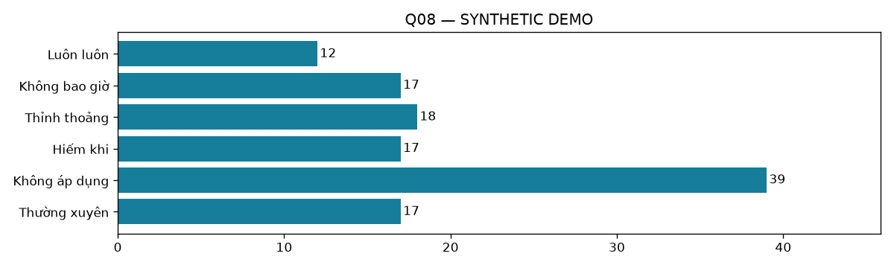

## Q09. Bạn đã gặp thông tin AI sai hoặc không có nguồn kiểm chứng chưa?

| Lựa chọn | Số lượt | % người trả lời câu |

|---|---:|---:|

| Không áp dụng | 45 | 37.50% |

| Không chắc | 23 | 19.17% |

| Không | 23 | 19.17% |

| Có | 29 | 24.17% |

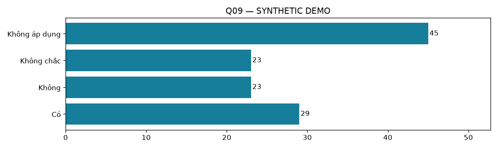

## Q10. Bạn đánh giá độ tin cậy chung của câu trả lời AI thế nào?

| Lựa chọn | Số lượt | % người trả lời câu |

|---|---:|---:|

| Rất thấp | 14 | 11.67% |

| Không áp dụng | 45 | 37.50% |

| Thấp | 16 | 13.33% |

| Rất cao | 14 | 11.67% |

| Trung bình | 13 | 10.83% |

| Cao | 18 | 15.00% |

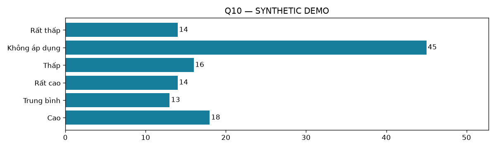

## Q11. AI giúp tôi hiểu rõ hơn kiến thức khó.

n hợp lệ=95; Không áp dụng=25; trung bình=3.01; trung vị=3; mức 4–5=43.2%

| Lựa chọn | Số lượt | % người trả lời câu |

|---|---:|---:|

| 1 | 18 | 15.00% |

| 3 | 12 | 10.00% |

| 4 | 21 | 17.50% |

| 5 | 20 | 16.67% |

| 2 | 24 | 20.00% |

| Không áp dụng | 25 | 20.83% |

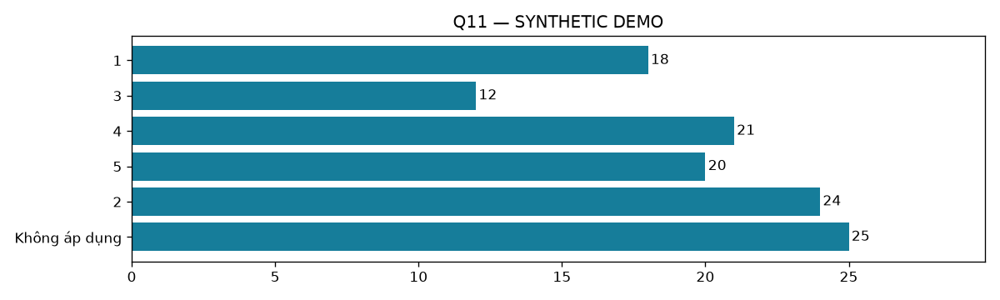

## Q12. AI giúp tôi tiết kiệm thời gian học tập.

n hợp lệ=95; Không áp dụng=25; trung bình=3.00; trung vị=3; mức 4–5=35.8%

| Lựa chọn | Số lượt | % người trả lời câu |

|---|---:|---:|

| 1 | 16 | 13.33% |

| 3 | 26 | 21.67% |

| 2 | 19 | 15.83% |

| 4 | 17 | 14.17% |

| 5 | 17 | 14.17% |

| Không áp dụng | 25 | 20.83% |

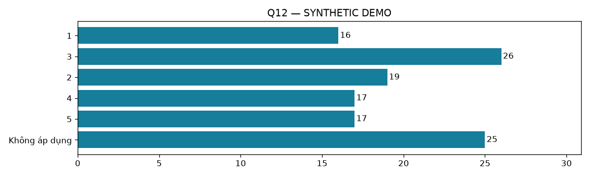

## Q13. AI giúp tôi tìm ra nhiều cách giải quyết bài tập.

n hợp lệ=95; Không áp dụng=25; trung bình=3.20; trung vị=4; mức 4–5=50.5%

| Lựa chọn | Số lượt | % người trả lời câu |

|---|---:|---:|

| 2 | 19 | 15.83% |

| 5 | 22 | 18.33% |

| 3 | 12 | 10.00% |

| 4 | 26 | 21.67% |

| 1 | 16 | 13.33% |

| Không áp dụng | 25 | 20.83% |

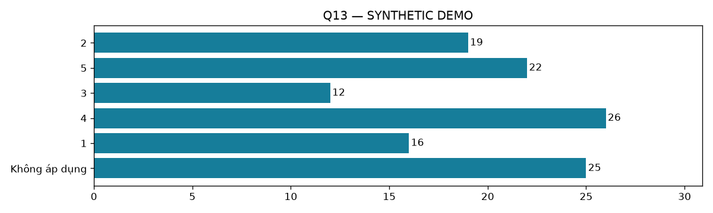

## Q14. Tôi có thể tự giải thích lại nội dung sau khi dùng AI.

n hợp lệ=95; Không áp dụng=25; trung bình=3.17; trung vị=3; mức 4–5=43.2%

| Lựa chọn | Số lượt | % người trả lời câu |

|---|---:|---:|

| 2 | 19 | 15.83% |

| 3 | 19 | 15.83% |

| 5 | 26 | 21.67% |

| 1 | 16 | 13.33% |

| Không áp dụng | 25 | 20.83% |

| 4 | 15 | 12.50% |

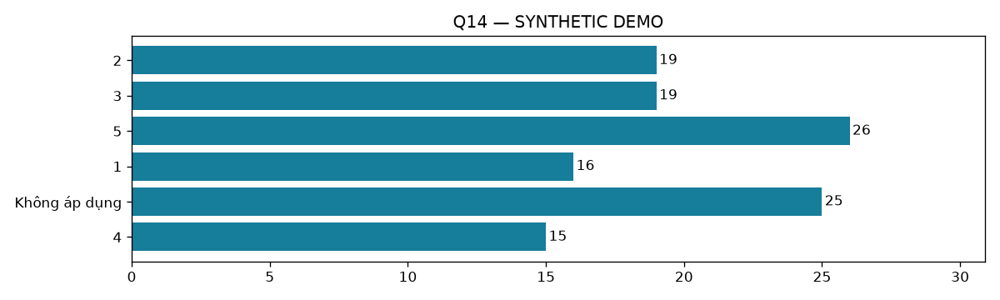

## Q15. Tôi lo mình phụ thuộc AI khi làm bài tập.

n hợp lệ=95; Không áp dụng=25; trung bình=3.16; trung vị=4; mức 4–5=52.6%

| Lựa chọn | Số lượt | % người trả lời câu |

|---|---:|---:|

| 5 | 20 | 16.67% |

| 1 | 22 | 18.33% |

| 2 | 11 | 9.17% |

| 3 | 12 | 10.00% |

| 4 | 30 | 25.00% |

| Không áp dụng | 25 | 20.83% |

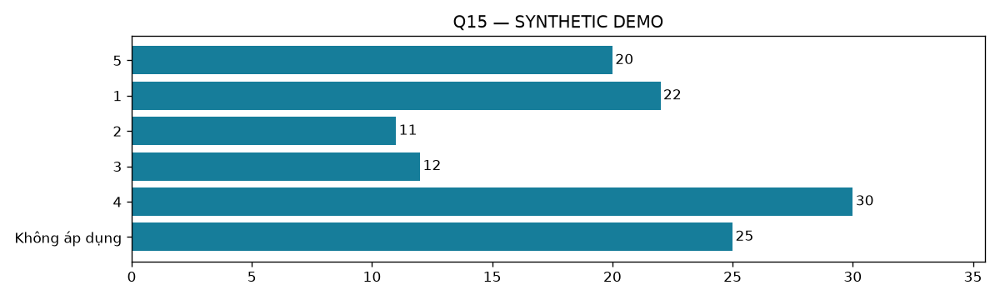

## Q16. Tôi gặp khó khăn khi đánh giá câu trả lời AI đúng hay sai.

n hợp lệ=95; Không áp dụng=25; trung bình=3.04; trung vị=3; mức 4–5=42.1%

| Lựa chọn | Số lượt | % người trả lời câu |

|---|---:|---:|

| 5 | 23 | 19.17% |

| 4 | 17 | 14.17% |

| 3 | 16 | 13.33% |

| 2 | 19 | 15.83% |

| 1 | 20 | 16.67% |

| Không áp dụng | 25 | 20.83% |

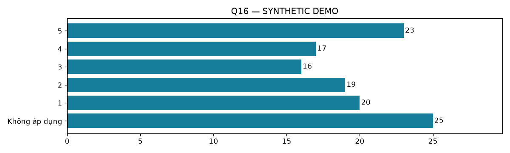

## Q17. Tôi biết khi nào cần ghi nhận việc sử dụng AI trong bài học.

n hợp lệ=95; Không áp dụng=25; trung bình=3.13; trung vị=3; mức 4–5=44.2%

| Lựa chọn | Số lượt | % người trả lời câu |

|---|---:|---:|

| 1 | 13 | 10.83% |

| 5 | 18 | 15.00% |

| 2 | 22 | 18.33% |

| 3 | 18 | 15.00% |

| 4 | 24 | 20.00% |

| Không áp dụng | 25 | 20.83% |

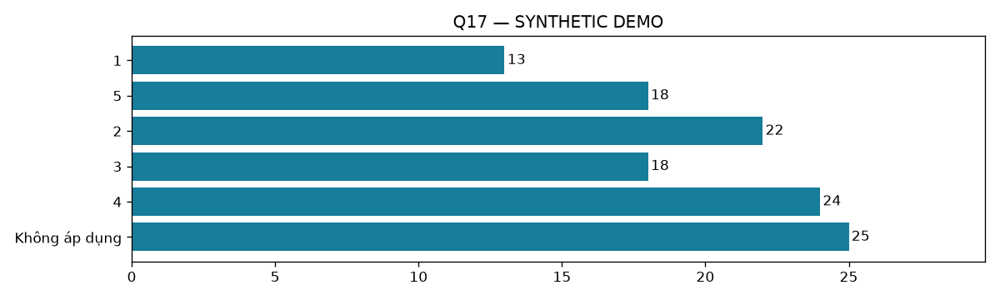

## Q18. Bạn gặp những khó khăn nào khi dùng AI cho học tập?

| Lựa chọn | Số lượt | % người trả lời câu |

|---|---:|---:|

| Quy định chưa rõ | 33 | 27.50% |

| Thiếu nguồn | 20 | 16.67% |

| Thông tin sai | 27 | 22.50% |

| Chi phí | 30 | 25.00% |

| Lo phụ thuộc | 30 | 25.00% |

| Khó đặt câu hỏi | 26 | 21.67% |

| Không áp dụng | 25 | 20.83% |

| Không gặp khó khăn | 24 | 20.00% |

Tổng % có thể vượt 100%; mẫu số là số người trả lời câu.

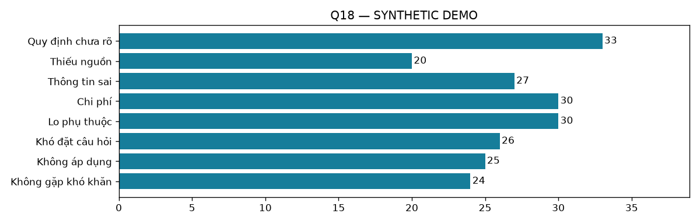

## Q19. Bạn đã được hướng dẫn về sử dụng AI trong học tập chưa?

| Lựa chọn | Số lượt | % người trả lời câu |

|---|---:|---:|

| Không nhớ | 40 | 33.33% |

| Có | 35 | 29.17% |

| Không | 45 | 37.50% |

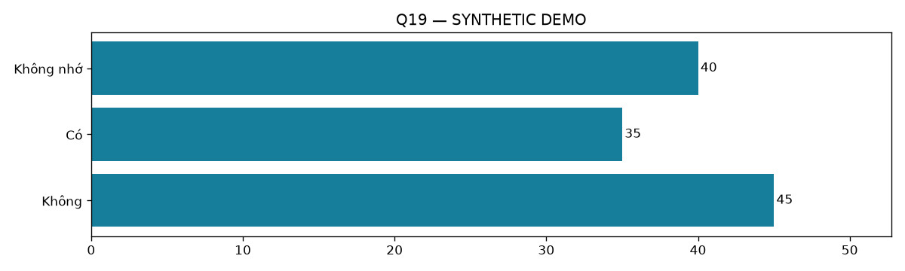

## Q20. Bạn muốn được hướng dẫn thêm nội dung gì?

| Lựa chọn | Số lượt | % người trả lời câu |

|---|---:|---:|

| Dùng AI theo môn học | 51 | 42.50% |

| Bảo vệ dữ liệu cá nhân | 54 | 45.00% |

| Ghi nhận sử dụng AI | 49 | 40.83% |

| Đặt câu hỏi hiệu quả | 43 | 35.83% |

| Kiểm chứng thông tin | 43 | 35.83% |

Tổng % có thể vượt 100%; mẫu số là số người trả lời câu.

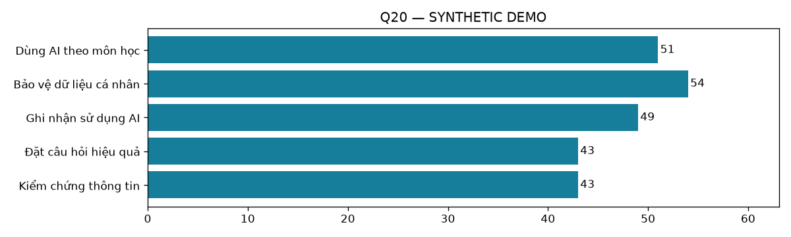

## Q21. Bạn dự định sử dụng AI trong học tập trong 3 tháng tới không?

| Lựa chọn | Số lượt | % người trả lời câu |

|---|---:|---:|

| Có | 36 | 30.00% |

| Chưa quyết định | 36 | 30.00% |

| Không | 48 | 40.00% |

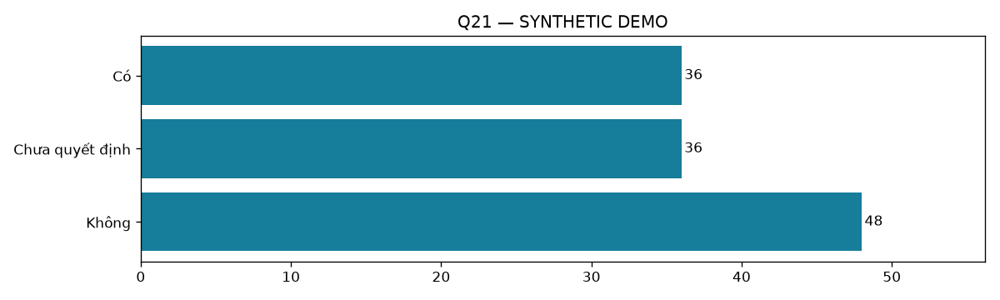

## Q22. Bạn có đề xuất gì để sử dụng AI hiệu quả và có trách nhiệm?

0 phản hồi không rỗng; không xuất nguyên văn.

## Giới hạn

Dữ liệu mô phỏng chỉ kiểm tra mã, không dùng làm bằng chứng nghiên cứu. Dữ liệu thật cần thiết kế lấy mẫu và kiểm tra mâu thuẫn trước khi kết luận. Hiệu quả là tự đánh giá, không chứng minh AI làm tăng điểm. Không tự gộp các mục Likert khác nội dung thành một thang đo.